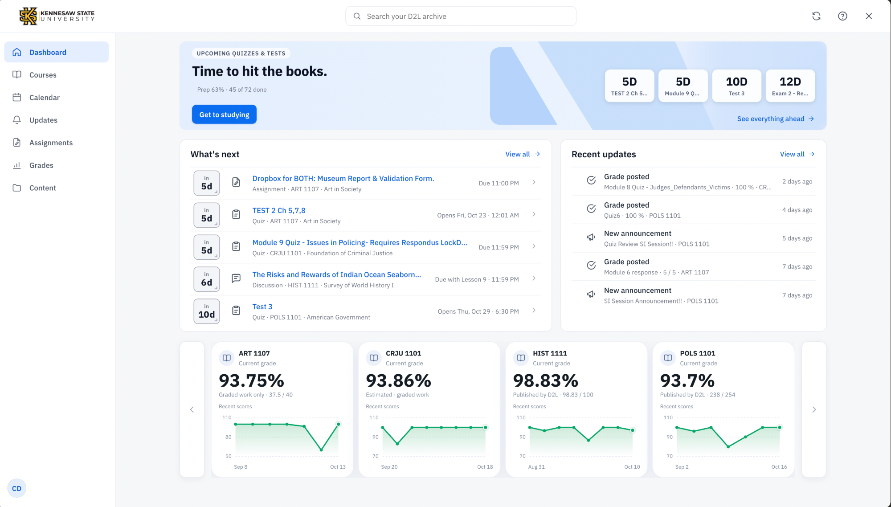
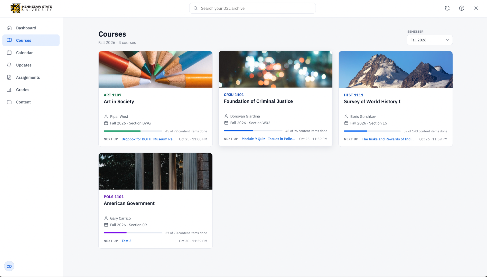
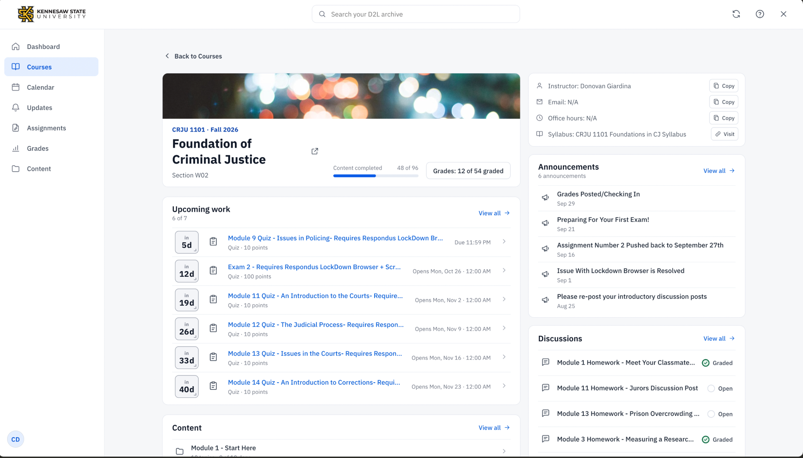
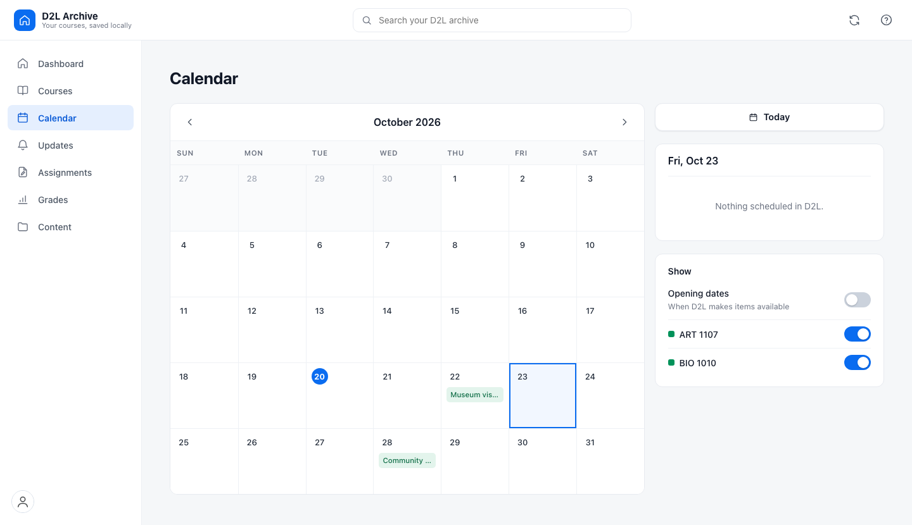
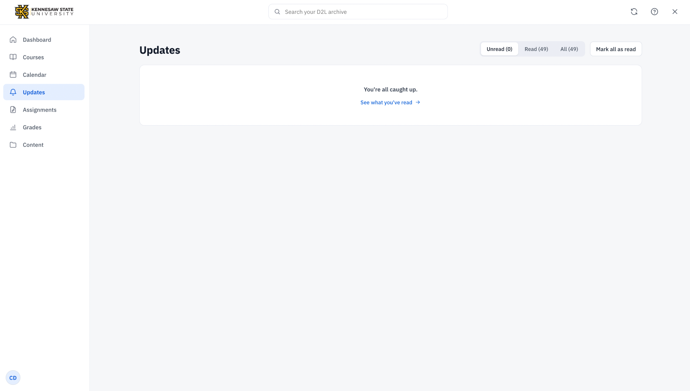
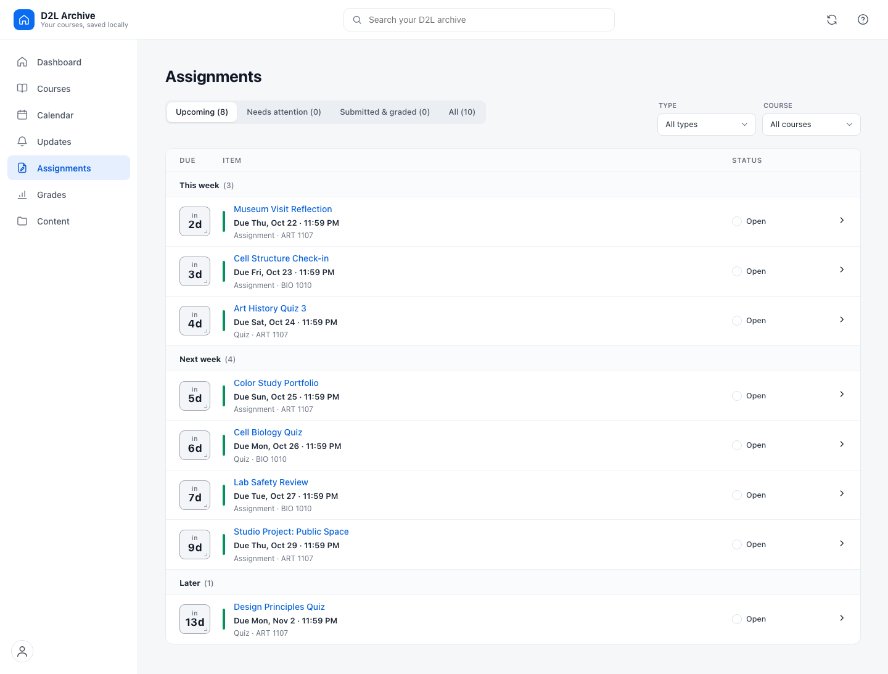
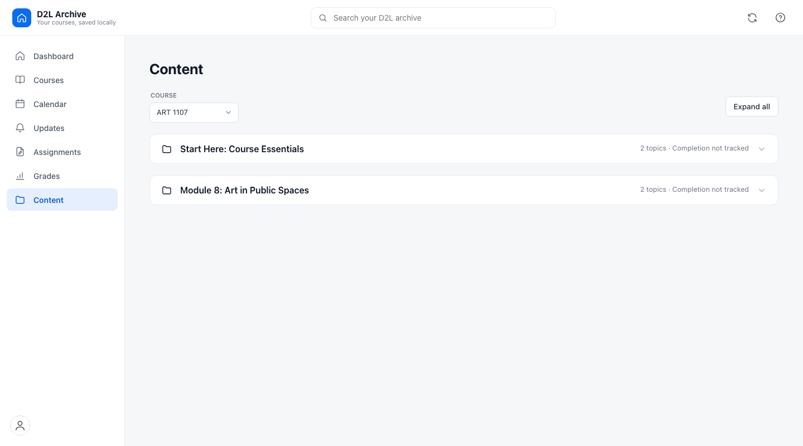

# D2L Archive

A read-only Chrome extension that turns your D2L courses into a local archive and a dashboard for upcoming work, updates, and grades.

It uses your existing D2L session. It does not post, submit work, start quizzes, or change D2L settings. No account, server, or telemetry.

Not affiliated with Kennesaw State University or D2L.

## Screenshots

Current app captures with real course data:

<table>
  <tr>
    <td align="center"><br>Dashboard</td>
    <td align="center"><br>Courses</td>
  </tr>
  <tr>
    <td align="center"><br>Course detail</td>
    <td align="center"><br>Calendar</td>
  </tr>
  <tr>
    <td align="center"><br>Updates</td>
    <td align="center"><br>Assignments</td>
  </tr>
  <tr>
    <td align="center"><br>Content</td>
    <td></td>
  </tr>
</table>

## Easy setup

Prefer a video? [Watch how to download and load an extension from GitHub](https://www.youtube.com/watch?v=PSqcV5eT8FM), or [see Chrome's Load unpacked steps](https://www.youtube.com/watch?v=xiT8c8M1OIw).

1. Open the [latest release](https://github.com/Dr-FacePlant/D2L-Archive/releases/latest) and download the `d2l-archive-*.zip` asset under **Assets**. Choose the named ZIP, not GitHub's **Source code** ZIP.
2. Extract the downloaded ZIP. The extracted folder should contain `manifest.json`.
3. In desktop Chrome, open `chrome://extensions`.
4. Turn on **Developer mode**, then click **Load unpacked**.
5. Select the extracted folder that contains `manifest.json`.
6. Visit [KSU D2L](https://kennesaw.view.usg.edu/d2l/). The overlay opens on your first visit; use the extension icon or `Alt+Shift+A` to toggle it later.

Course-file downloads are optional and off by default. Turn them on in Settings if you want files included in your export.

## What you can do

- See upcoming assignments and quizzes, recent course updates, and grade summaries from the dashboard.
- Browse courses, assignments, calendar events, announcements, discussions, grades, and course content.
- Search archived course data and open items in D2L using their original links.
- Save a portable archive of JSON, CSV, Markdown, and page snapshots for offline review.

## Privacy

Course data and exports stay on your device. Requests go only to your D2L site using your existing session; the extension has no analytics or third-party server. It only reads D2L data. To submit work or post, open the item in D2L and do it there yourself.

<details>
<summary>Developer and archive reference</summary>

### Development

```sh
node run-local-checks.mjs
node tools/validate-extension.mjs
```

The local checks use Node 20+ and need no additional dependencies. To preview the dashboard against saved exports:

```sh
node tools/dev-dashboard-preview.mjs 8791
```

### Archive tools

Exports are saved under `~/Downloads/D2L Export/d2l-export-<timestamp>/`. They include a manifest, course data, readable page snapshots, and audit/change reports. Course files are included only when enabled. The ignored `dashboard-test-exports.json` can point local preview tools at personal exports and is not included in Git.

```sh
node tools/verify-archive.mjs "$HOME/Downloads/D2L Export/d2l-export-..."
node tools/verify-latest.mjs
node tools/query-ai-index.mjs "$HOME/Downloads/D2L Export/d2l-export-..." "quiz feedback due"
```

An export records coverage and gaps. D2L permissions vary by course, so submitted-file downloads, instructor comments, quiz question-level results, and discussion grading feedback may be unavailable.

### Repository layout

```text
background.js, content.js, popup.*   extension entrypoints
manifest.json                        Chrome MV3 manifest
src/                                 extension features and shared code
tests/                               regression suite and synthetic fixtures
tools/                               archive, validation, and preview CLIs
docs/                                specifications, field maps, and notes
```

`node tools/package.mjs` builds a zip containing only runtime files. See [`docs/VALENCE-API-MAP.md`](docs/VALENCE-API-MAP.md), [`docs/PRE-RELEASE-IMPLEMENTATION-PLAN.md`](docs/PRE-RELEASE-IMPLEMENTATION-PLAN.md), and [`docs/store-listing.md`](docs/store-listing.md) for deeper technical and release notes.

</details>

## License

MIT — see [`LICENSE`](LICENSE).
