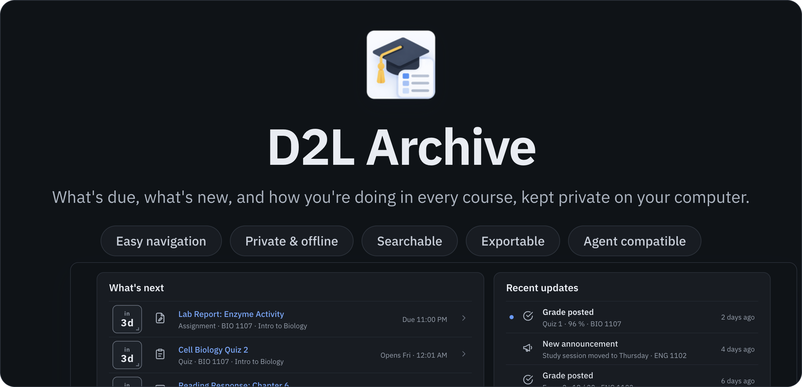
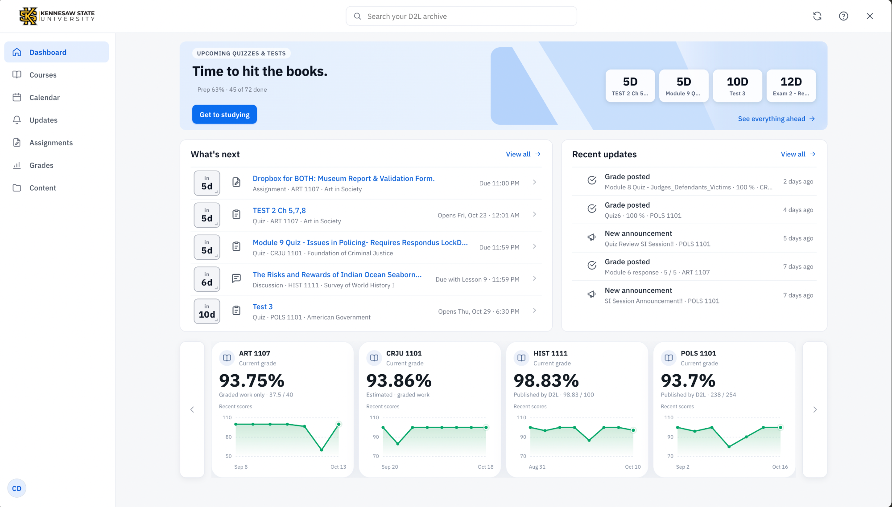
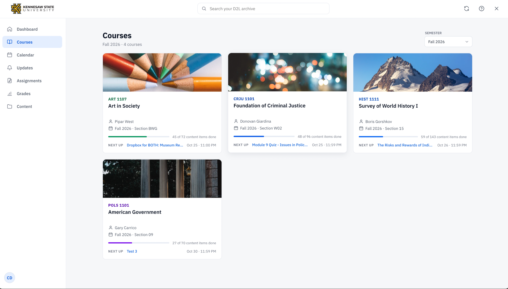
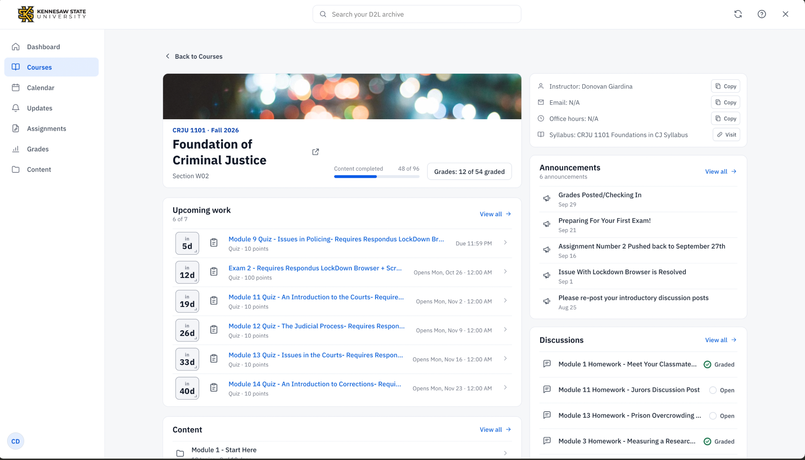
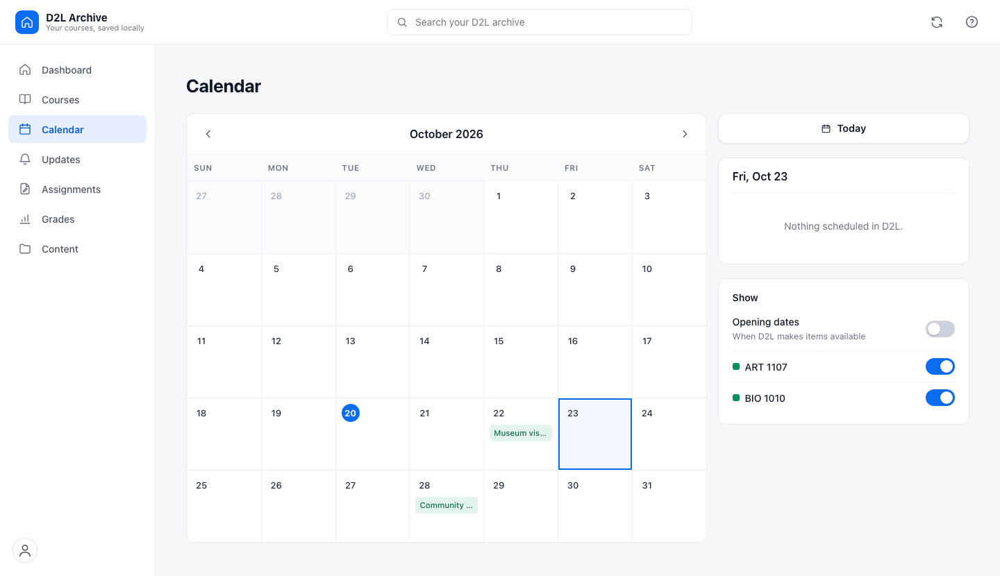
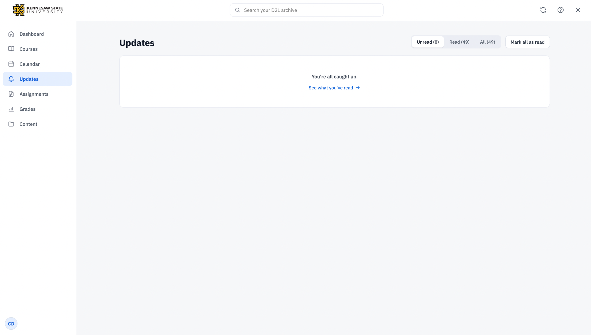
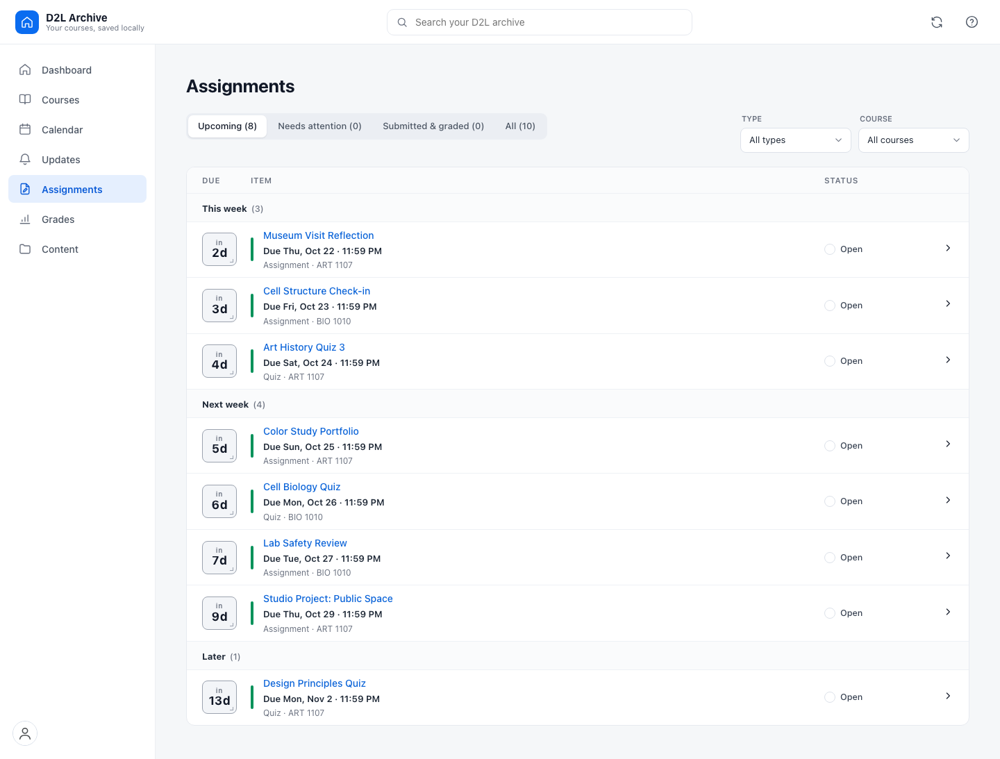
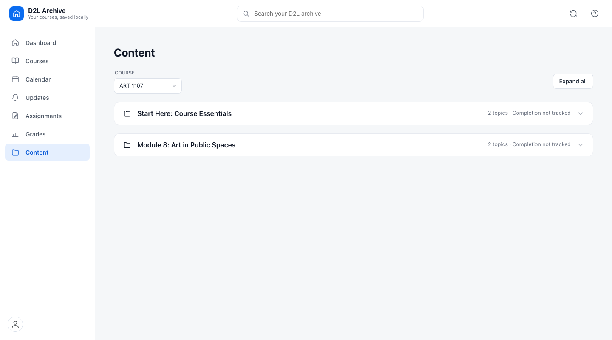

<p align="center">
  <picture>
    <source media="(prefers-color-scheme: dark)" srcset="docs/banner-light.png">
    
  </picture>
</p>

<p align="center">
  <b>A read-only Chrome extension for <a href="https://www.kennesaw.edu/">Kennesaw State University</a> (it will expand to all D2L portals, but for now it only supports Kennesaw State University) that turns your D2L courses into a local archive and a dashboard for upcoming work, updates, and grades.</b>
</p>

<p align="center">
  
  
  
  
  
</p>

> [!NOTE]
> D2L Archive currently supports **Kennesaw State University only**. Support for other D2L portals is planned. It isn't on the Chrome Web Store yet, so install it from the release ZIP; the steps are under [Getting started](#getting-started).

> [!IMPORTANT]
> D2L Archive **only reads** your D2L data. To submit work or post, open the item in D2L and do it there yourself. It is an independent project and is **not affiliated with or endorsed by** Kennesaw State University or D2L Corporation.

---

Built for the daily check: what needs attention today, what's due soon, and how you're doing in every course. When it's time to act, it's two clicks to the assignment upload page instead of digging through the busy interface. Your course data and exports stay on your computer.

---

## Features

<table>
<tr>
  <td width="190"><b>Dashboard</b><br><sub><code>available now</code></sub></td>
  <td>Upcoming assignments and quizzes, recent course updates, and a grade snapshot for every course, on one screen.</td>
</tr>
<tr>
  <td><b>Courses and calendar</b><br><sub><code>available now</code></sub></td>
  <td>Browse courses, assignments, calendar events, announcements, discussions, grades, and course content, with a link back to each item in D2L.</td>
</tr>
<tr>
  <td><b>Search</b><br><sub><code>available now</code></sub></td>
  <td>Search everything you've archived and open any result in D2L using its original link.</td>
</tr>
<tr>
  <td><b>Export</b><br><sub><code>available now</code></sub></td>
  <td>Save a portable archive of JSON, CSV, Markdown, and page snapshots for offline review. Course-file downloads are optional and off by default.</td>
</tr>
<tr>
  <td><b>Agent compatible</b><br><sub><code>partly available</code></sub></td>
  <td>Not fully agent compatible yet. Every export includes an <code>ai-index.ndjson</code> file, and <code>tools/query-ai-index.mjs</code> searches it, so an AI agent can read your exported archive. Full agent compatibility, through an MCP server, is planned.</td>
</tr>
<tr>
  <td><b>Private by design</b><br><sub><code>available now</code></sub></td>
  <td>Requests go only to KSU's D2L site, using your existing session. There is no analytics and no third-party server. Read the <a href="https://dr-faceplant.github.io/D2L-Archive/privacy-policy.html">privacy policy</a>.</td>
</tr>
</table>

<details>
<summary><b>Screenshots</b></summary>

<table>
  <tr>
    <td align="center"><br>Dashboard</td>
    <td align="center"><br>Courses</td>
  </tr>
  <tr>
    <td align="center"><br>Course detail</td>
    <td align="center"><br>Calendar</td>
  </tr>
  <tr>
    <td align="center"><br>Updates</td>
    <td align="center"><br>Assignments</td>
  </tr>
  <tr>
    <td align="center"><br>Content</td>
    <td></td>
  </tr>
</table>

</details>

---

## Getting started

### Prerequisites

- **Desktop Chrome** (the extension uses Manifest V3)
- A **KSU D2L account**, signed in at [kennesaw.view.usg.edu/d2l](https://kennesaw.view.usg.edu/d2l/) (other portals aren't supported yet)

### Install

1. Download the `d2l-archive-*.zip` asset from the [latest release](https://github.com/Dr-FacePlant/D2L-Archive/releases/latest). Skip GitHub's **Source code** ZIP.
2. Extract it. The folder should have `manifest.json` at its top level.
3. In Chrome, open `chrome://extensions`, turn on **Developer mode**, click **Load unpacked**, and select that folder.

Then visit [KSU D2L](https://kennesaw.view.usg.edu/d2l/). The overlay opens on your first visit (refresh the tab if D2L was already open). Use the extension icon or `Alt+Shift+A` to toggle it later.

### Build and test

```bash
node run-local-checks.mjs
node tools/validate-extension.mjs
```

The local checks use Node 20+ and need no extra dependencies. To preview the dashboard against saved exports, put a `dashboard-test-exports.json` at the repo root (see `dashboard-test-exports.example.json`) and run:

```bash
node tools/dev-dashboard-preview.mjs 8791
```

<details>
<summary><b>Archive tools</b></summary>

Exports are saved under `~/Downloads/D2L Export/d2l-export-<timestamp>/`. They include a manifest, course data, readable page snapshots, and audit and change reports. Course files are included only when enabled.

```bash
node tools/verify-archive.mjs "$HOME/Downloads/D2L Export/d2l-export-..."
node tools/verify-latest.mjs
node tools/query-ai-index.mjs "$HOME/Downloads/D2L Export/d2l-export-..." "quiz feedback due"
```

</details>

---

## How it fits together

D2L Archive reads your courses through your own D2L session, keeps them in the browser, and shows them in a dashboard.

The D2L calls it reads are mapped in [`docs/VALENCE-API-MAP.md`](docs/VALENCE-API-MAP.md).

| Part | Where it lives | Role |
|---|---|---|
| **Sync and archive** | `background.js`, `src/background/` | Reads your courses, organizes what it finds, and writes exports. |
| **Page reader** | `src/content/` | Runs on D2L pages: finds the data and opens the overlay. |
| **Dashboard** | `dashboard.html`, `src/dashboard/` | The screens you use: dashboard, courses, calendar, updates, assignments, grades, content. |
| **Popup** | `popup.html`, `popup.js` | The extension icon's popup. |
| **Tools and tests** | `tools/`, `tests/` | Archive verification, search, previews and the test suite. |

---

## Project status & roadmap

- [x] Dashboard, courses, calendar, updates, assignments, grades and content
- [x] Search across the archive
- [x] Local export with verification tools
- [x] Agent-readable index in every export
- [ ] Full agent compatibility through an MCP server
- [ ] Support for other D2L portals
- [ ] Chrome Web Store listing

---

## Get involved

Bugs, ideas and feature requests are welcome.

- [Open an issue](https://github.com/Dr-FacePlant/D2L-Archive/issues)
- Fork, run the checks above, and open a pull request

---

## License

Released under the [MIT License](LICENSE).

---

<p align="center">
  <sub>D2L Archive is an independent project and is not affiliated with or endorsed by Kennesaw State University or D2L Corporation.</sub>
</p>
