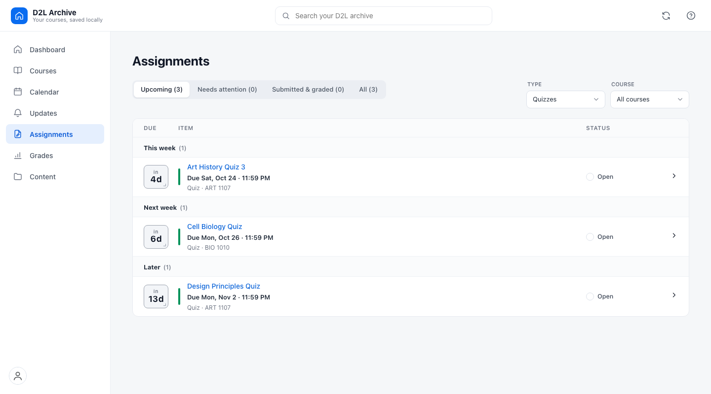
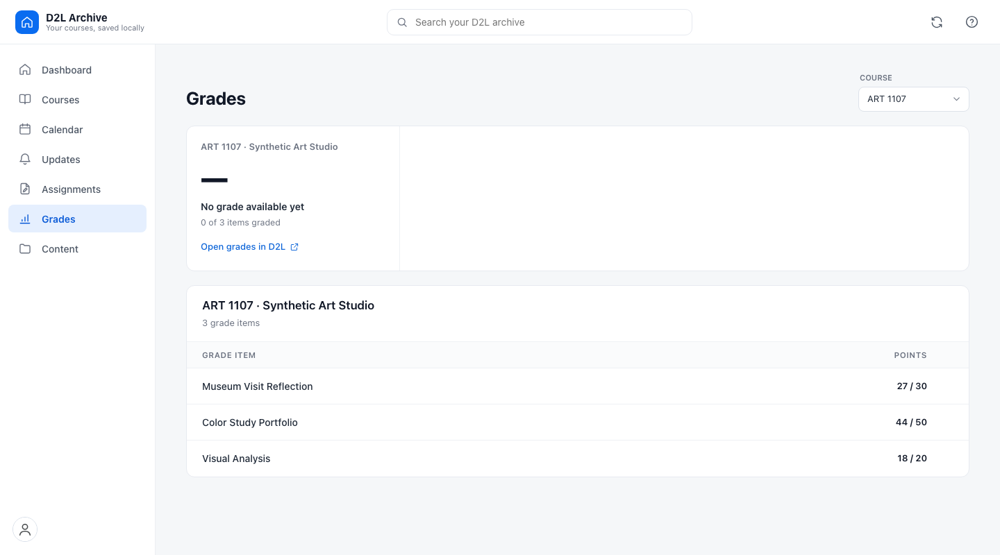
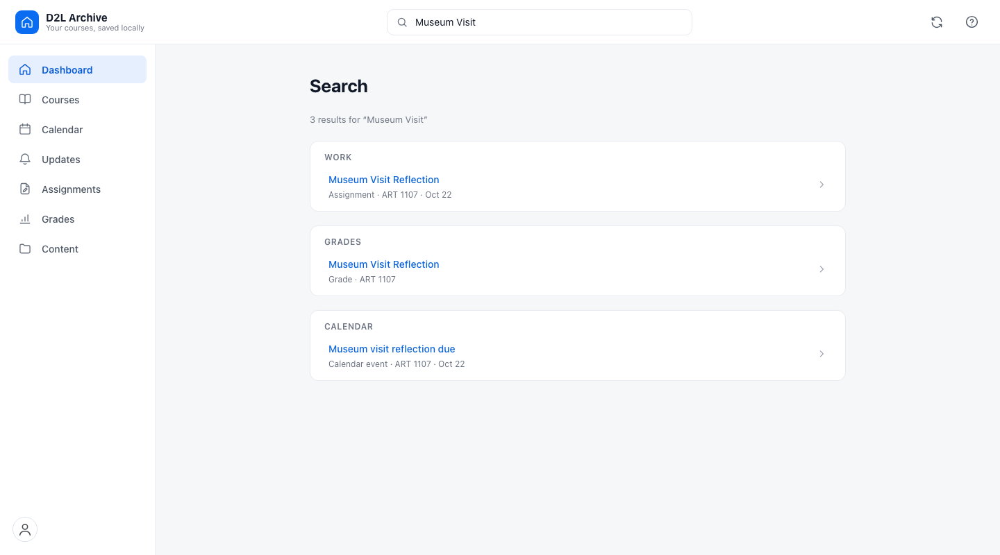
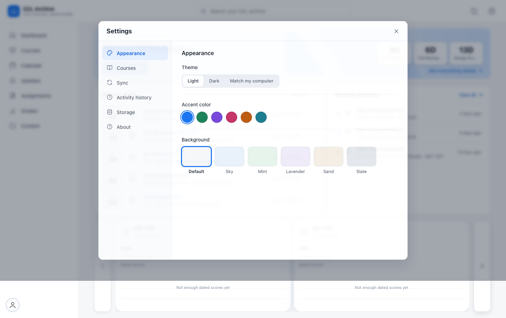
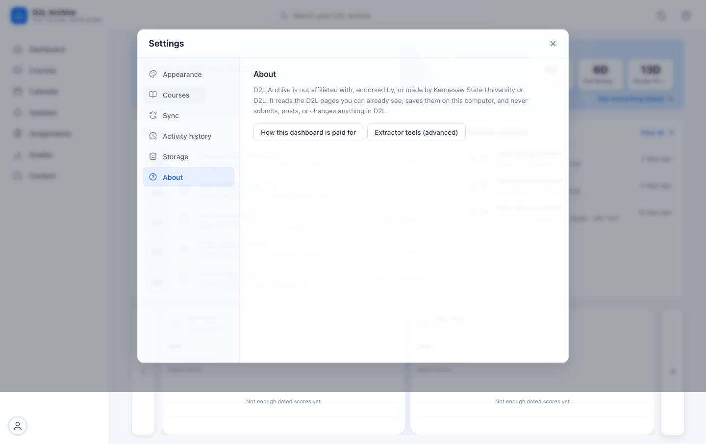
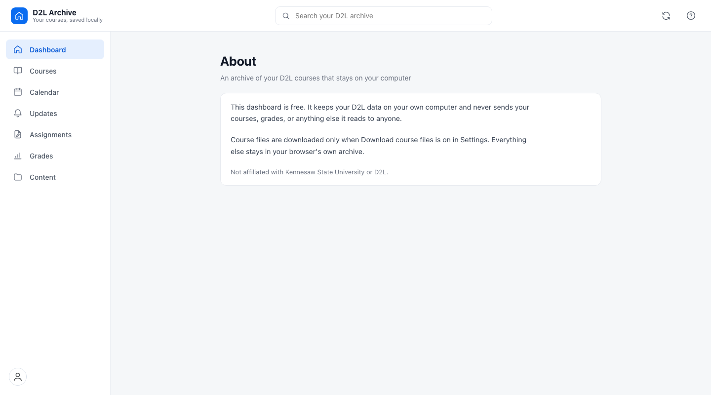

# Dashboard screenshots

These screenshots show the current dashboard UI with **synthetic sample data**.
They were rendered from the app's page templates and styles. Names, courses,
assignments, dates, grades, and other course details shown here are fictional;
no signed-in D2L account data is included.

## Dashboard

## Courses

## Course detail

## Calendar

## Updates

## Assignments

## Quizzes filter

The Assignments screen with the Quizzes type filter selected.

## Grades

## Content

## Search

## Settings

## About

